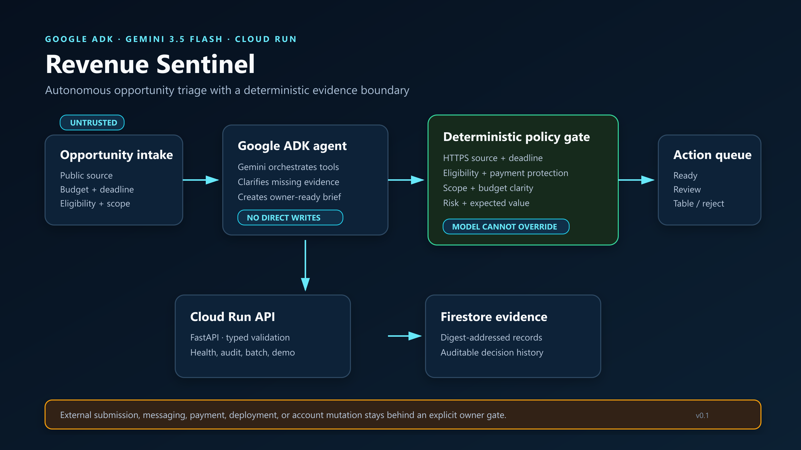

# Revenue Sentinel

Revenue Sentinel is an autonomous, evidence-first opportunity auditor built for the Google All Things Agentic Hackathon. It converts noisy leads, bounties, contracts, and contests into a deterministic action queue before a generative model can recommend external action.

The core refuses to treat a lead as revenue. It independently represents deadline, eligibility, source quality, buyer verification, payment protection, scope clarity, and budget clarity; calculates a bounded expected value; produces a SHA-256 evidence digest; and preserves explicit owner gates for submissions, messages, payments, deployments, and account changes.

## Project evidence and demo status



[Demo video](https://youtu.be/TSp3dc-k1Ys) · [Architecture](ARCHITECTURE.md) · [Verification record](VERIFICATION.md) · [Submission](https://devpost.com/software/revenue-sentinel-25chxk)

The dated verification record documents a September 1, 2026 Cloud Run deployment, Gemini tool call, and Firestore write. A fresh check on October 14, 2026 returned HTTP 404 from `/api/health` on both recorded regional URLs. **The hosted demo is currently unavailable at those URLs; use the credential-free local demo below.** Historical deployment evidence is not a claim of current availability.

## Why it exists

Revenue work is usually a messy multi-step chore: find leads, verify they are still open, inspect rules, check eligibility, reject scams and dust-value work, compare expected value, prepare evidence, and decide what needs a human. Generic chat agents can skip gates or invent certainty. Revenue Sentinel makes the safety and evidence layer deterministic, then gives Google ADK and Gemini a small set of auditable tools.

## Architecture

- **Google ADK + Gemini 3.5 Flash** orchestrate the audit and brief tools in `app/agent.py`.
- **Deterministic policy engine** owns hard gates, risk scoring, expected value, sorting, and action boundaries.
- **FastAPI on Cloud Run** exposes the audit API, credential-free demo, health check, and compact dashboard.
- **Cloud Firestore** stores deployed audit results by their evidence digest. Local demos use an in-memory or chained JSONL ledger.
- **SHA-256 evidence digests** make any material input or decision change visible.

The LLM cannot override a closed deadline, failed eligibility check, invalid source, dust-value result, or owner-review gate. Opportunity text is untrusted data, not executable instruction.

## Quick start

Python 3.12 is recommended.

```powershell
uv sync --python 3.12 --extra dev
uv run pytest
uv run ruff check .
uv run revenue-sentinel fixtures/opportunities.json --pretty
uv run uvicorn main:app --host 127.0.0.1 --port 8080
```

Then open `http://127.0.0.1:8080`, call `POST /api/demo`, or inspect `http://127.0.0.1:8080/docs`.

The deterministic demo needs no API key, cloud account, buyer data, or network access. The ADK agent requires normal Google credentials when invoked through an ADK runner.

## Opportunity schema

Required fields are `opportunity_id`, `title`, `source_url`, `channel`, and `potential_value_usd`. Evidence and gates are explicit fields:

```json
{
  "opportunity_id": "contest-1",
  "title": "Verified contest",
  "source_url": "https://example.com/contest",
  "channel": "Hackathon",
  "potential_value_usd": 10000,
  "deadline_iso": "2099-09-01T00:00:00Z",
  "eligible": null,
  "buyer_verified": true,
  "payment_protected": null,
  "budget_clear": true,
  "scope_clear": true,
  "public_evidence": ["https://example.com/contest", "https://example.com/rules"],
  "external_actions": ["join", "deploy", "submit"]
}
```

Unknown facts remain `null`; they are never silently converted to approval.

## API

- `GET /api/health` - public liveness probe. (`/healthz` remains available locally.)
- `GET /` - interactive product proof page.
- `POST /api/audit` - audit and persist one opportunity.
- `POST /api/audit/batch` - score and sort up to 100 opportunities.
- `POST /api/demo` - run the five-case credential-free fixture.
- `POST /api/agent/audit` - run one bounded Google ADK/Gemini audit and return the tool trace.

## Deploy to Google Cloud

Deployment is intentionally explicit because it creates cloud resources and may incur charges. Review the project, choose a dedicated Google Cloud project, confirm billing, and then run:

```powershell
./infra/deploy.ps1 -ProjectId YOUR_PROJECT_ID -Region us-west2
```

The script enables Cloud Run, Cloud Build, Firestore, and Vertex AI, then performs a source deployment. For least privilege, create the `revenue-sentinel-runtime` service account and grant only the Firestore and Vertex permissions the runtime needs before production use. Set maximum instances and a budget alert before public traffic.

## Verification boundary

What the repository proves locally:

- deterministic source/deadline/eligibility/evidence/payment/scope gates;
- bounded probability and expected-value ranking;
- explicit external-action approvals;
- tamper-evident chained local ledger;
- typed API validation and a credential-free five-case demo;
- a real Google ADK agent definition using Gemini 3.5 Flash;
- Cloud Run, Vertex AI, and Firestore deployment configuration.

Historical external verification is documented in [VERIFICATION.md](VERIFICATION.md), including cloud execution and public submission. These dated records do not establish current service availability. Current public health checks are recorded above.

Neither the local demo nor those records establish a prize, production adoption, customers, sales, or revenue. External messages, submissions, payments, deployments, and account changes remain subject to owner authorization.

## License

Apache-2.0. See `LICENSE`.
